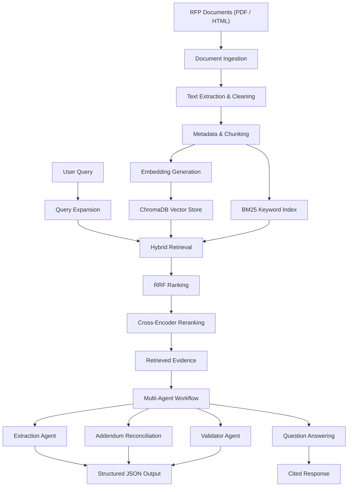

# RFP Intelligence Platform
### RAG Search Engine & Multi-Agent System

An AI-powered platform for processing Request for Proposal (RFP) documents, retrieving relevant information, answering bid-related questions, and extracting structured procurement data with source citations.

The platform combines document ingestion, semantic search, keyword-based retrieval, hybrid ranking, and a multi-agent workflow to make complex bid documents easier to analyze.

---

## 1. Project Overview

RFP documents often contain large amounts of information spread across multiple PDFs, HTML documents, specifications, and addenda. Manually identifying requirements, deadlines, product specifications, and compliance conditions can be time-consuming.

This project addresses that problem through a Retrieval-Augmented Generation (RAG) pipeline and a multi-agent architecture.

### Key Features

- PDF and HTML document ingestion.
- Text cleaning and page-level metadata extraction.
- Persistent vector indexing using ChromaDB.
- Semantic search using Sentence Transformers.
- Keyword retrieval using BM25.
- Hybrid retrieval using Reciprocal Rank Fusion (RRF).
- Cross-encoder reranking.
- Metadata-based filtering.
- Multi-agent document analysis and structured extraction.
- Addendum reconciliation and validation.
- Question answering with source citations.
- REST API and command-line interfaces.
- Retrieval evaluation across multiple configurations.

---

## 2. Architecture

The platform follows a modular architecture in which documents are processed and indexed before being accessed through retrieval and agent workflows.



---

## 3. Technology Stack

| Component | Technology |
|---|---|
| Programming Language | Python 3.10+ |
| Document Processing | pdfplumber, BeautifulSoup |
| Vector Database | ChromaDB |
| Embeddings | Sentence Transformers |
| Embedding Model | all-MiniLM-L6-v2 |
| Keyword Search | BM25 (rank-bm25) |
| Hybrid Ranking | Reciprocal Rank Fusion |
| Reranking | Cross-Encoder |
| Reranker Model | cross-encoder/ms-marco-MiniLM-L-6-v2 |
| LLM Integration | Google Gemini API |
| Data Validation | Pydantic |
| API Framework | FastAPI |
| Testing | Pytest |

---

## 4. Project Structure

```text
rfp-intelligence-platform/
│
├── agents/
│   └── workflow.py
│
├── api/
│   └── server.py
│
├── data/
│   ├── Bid1/
│   └── Bid2/
│
├── eval/
│
├── ingestion/
│   └── parser.py
│
├── outputs/
│   ├── agent_trace_Bid1.json
│   ├── agent_trace_Bid2.json
│   ├── Bid1.json
│   ├── Bid2.json
│   ├── qa_log.md
│   ├── qa_log_backup.md
│   ├── qa_log_retrieval.md
│   ├── retrieval_eval.json
│   └── retrieval_eval.md
│
├── search/
│   └── engine.py
│
├── tests/
│
├── cli.py
├── main.py
├── qa_log.py
├── qa_log_offline.py
├── requirements.txt
└── README.md
```

Generated vector database files and other runtime artifacts may be stored separately depending on the local execution environment.

---

## 5. Installation and Setup

### Prerequisites

- Python 3.10 or newer.
- pip.
- Google Gemini API key for live LLM-powered operations.

### Step 1: Clone the repository

```bash
git clone <repository-url>
cd rfp-intelligence-platform
```

### Step 2: Create a virtual environment

```bash
python -m venv venv
```

Activate it on Windows:

```powershell
.\venv\Scripts\Activate.ps1
```

### Step 3: Install dependencies

```bash
pip install -r requirements.txt
```

### Step 4: Configure environment variables

Create a `.env` file in the project root:

```env
GEMINI_API_KEY=your_api_key_here
LLM_MODEL=gemini-3.8-flash
```

Keep API credentials private. Never commit `.env` to the repository.

---

## 6. Running the Application

### Start the REST API

```bash
uvicorn api.server:app --port 8000
```

Open the interactive API documentation:

```text
http://127.0.0.1:8000/docs
```

### Available API Endpoints

| Method | Endpoint | Purpose |
|---|---|---|
| GET | `/health` | Health check |
| POST | `/search` | Search indexed bid documents |
| POST | `/ask` | Ask questions about bid documents |
| GET | `/bids/{bid_id}` | Retrieve bid-related information |

### Command-Line Interface

The project provides two command-line entry points.

#### A. Search and Q&A — `cli.py`

Search bid documents without using an LLM:

```bash
python cli.py search "payment terms"
```

Search within a specific bid:

```bash
python cli.py search "warranty" --bid Bid1
```

Choose a retrieval mode:

```bash
python cli.py search "delivery deadline" --mode hybrid_rerank
```

Ask a question using the LLM-powered workflow (requires Gemini API access and available quota):

```bash
python cli.py ask "What is the bid due date?" --bid Bid1
```

Available search modes: `vector`, `hybrid`, and `hybrid_rerank`.

**Note:** `cli.py` currently indexes the supplied `data/Bid1` and `data/Bid2` folders when it starts.

#### B. Extraction and Q&A — `main.py`

Run the multi-agent extraction pipeline on a bid folder:

```bash
python main.py data/Bid1
```

Run Q&A:

```bash
python main.py ask -q "What is the bid due date?" -b Bid1
```

The extraction entry point accepts a bid-folder path. Support for an unseen folder should be confirmed with an end-to-end test before claiming it has been verified.


---

## 7. Document Ingestion

The ingestion module processes PDF and HTML documents.

The parser includes functionality for:

- PDF text extraction using pdfplumber.
- HTML parsing using BeautifulSoup.
- Text cleaning and normalization.
- Page-level extraction.
- Document type detection.
- Addendum number detection.
- Table formatting utilities.
- Metadata generation.

### Metadata

Each indexed document chunk can contain:

| Field | Description |
|---|---|
| bid_id | Associated bid identifier |
| file_name | Original document filename |
| doc_type | Document classification |
| addendum_number | Associated addendum number, where available |
| page_number | Original document page number |

This metadata supports filtering and source attribution during retrieval.

---

## 8. RAG Search Engine

The retrieval system combines semantic and keyword-based search.

### Chunking Strategy

The current implementation uses paragraph-based, page-aware chunking.

- Target chunk size: approximately 1,000 characters.
- Overlap: approximately 200 characters.
- Maximum chunk guard: 2,500 characters.
- Chunks retain document and page metadata.

This approach helps preserve relevant context while maintaining traceability to the original document.

### Embeddings

Sentence Transformers generates dense vector embeddings using:

`all-MiniLM-L6-v2`

The embeddings are stored persistently in ChromaDB.

### Keyword Retrieval

BM25 provides keyword-based retrieval, helping identify exact terms such as:

- Bid numbers.
- Product model numbers.
- Part numbers.
- Contract identifiers.
- Dates and procurement terminology.

### Hybrid Retrieval

The search engine combines dense vector results and BM25 results using Reciprocal Rank Fusion (RRF).

The current implementation uses an RRF constant of 60.

### Reranking

A cross-encoder reranker evaluates retrieved query-document pairs and improves their relevance ordering.

Three retrieval configurations are available:

1. `vector` – semantic vector retrieval.
2. `hybrid` – vector and BM25 retrieval with RRF.
3. `hybrid_rerank` – hybrid retrieval followed by cross-encoder reranking.

### Incremental Indexing

The indexing implementation uses hash-based chunk identifiers and ChromaDB upsert operations to support incremental indexing.

---

## 9. Multi-Agent System

The agent workflow is implemented in `agents/workflow.py`.

The system uses structured Pydantic models to organize extraction, reconciliation, validation, and question-answering results.

### Agent Responsibilities

| Agent / Component | Responsibility |
|---|---|
| Orchestrator | Coordinates the document analysis workflow |
| Retrieval Agent | Retrieves relevant passages from the search engine |
| Extraction Specialist | Extracts structured procurement fields |
| Addendum Reconciliation Agent | Identifies changes introduced through addenda |
| Validator Agent | Reviews extracted information and validation results |
| Q&A Workflow | Generates answers using retrieved document evidence |

### Structured Outputs

The workflow uses Pydantic models for:

- Source citations.
- Extracted fields.
- Extraction batches.
- Addendum changes.
- Reconciliation results.
- Validation reports.
- Question-answering responses.

The objective is to maintain structured, traceable outputs rather than relying on unstructured responses.

---

## 10. Structured Information Extraction

The extraction workflow generates structured JSON outputs for individual bids.

The requested fields include:

1. Bid Number
2. Title
3. Due Date
4. Bid Submission Type
5. Term
6. Pre Bid Meeting
7. Installation
8. Bid Bond
9. Delivery Date
10. Payment Terms
11. Additional Documentation
12. MFG Registration
13. Contract / Cooperative
14. Model Number
15. Part Number
16. Product
17. Contact Information
18. Company Name
19. Bid Summary
20. Product Specification

Each extracted field is designed to include:

- Extracted value.
- Source citation.
- Confidence.
- Notes.

When information is unavailable, the intended behavior is to avoid inventing values and represent missing information explicitly.

### Generated Extraction Files

```text
outputs/
├── Bid1.json
└── Bid2.json
```

Agent execution traces:

```text
outputs/
├── agent_trace_Bid1.json
└── agent_trace_Bid2.json
```

---

## 11. Retrieval Evaluation

The retrieval engine was evaluated using 26 questions across the two provided bid datasets.

Three configurations were compared:

- Vector retrieval.
- Hybrid retrieval.
- Hybrid retrieval with reranking.

### Evaluation Results

| Configuration | Recall@1 | Recall@3 | Recall@5 | Recall@10 | MRR |
|---|---:|---:|---:|---:|---:|
| Vector | 0.462 | 0.808 | 0.885 | 0.923 | 0.644 |
| Hybrid | 0.808 | 0.885 | 0.923 | 0.962 | 0.848 |
| Hybrid + Reranking | 0.769 | 1.000 | 1.000 | 1.000 | 0.865 |

### Observations

- Hybrid retrieval improved Recall@1 from 46.2% to 80.8% compared with vector-only retrieval.
- Hybrid retrieval with reranking achieved 100% Recall@3, Recall@5, and Recall@10 on this evaluation set.
- Hybrid retrieval with reranking achieved the highest MRR of 0.865.
- Hybrid retrieval without reranking achieved the highest Recall@1 at 80.8%.

The results indicate that combining semantic and keyword retrieval improves retrieval performance on the tested questions.

Evaluation results are specific to the current dataset and question set; they should not be interpreted as a guarantee of performance on every RFP collection.

### Evaluation Files

```text
outputs/
├── retrieval_eval.json
└── retrieval_eval.md
```

---

## 12. Question Answering and Evidence Logs

The project includes two separate forms of question-answering evidence.

### LLM-Powered Q&A

`qa_log.py` runs questions through the LLM-powered workflow and records generated answers with citations.

Output:

```text
outputs/qa_log.md
```

This workflow requires a working Gemini API quota.

### Offline Retrieval Evidence

`qa_log_offline.py` retrieves relevant passages from the existing local index without making Gemini API calls.

Output:

```text
outputs/qa_log_retrieval.md
```

This report records retrieved evidence, including document names, page numbers, and relevant text passages.

**Important:** Offline retrieval evidence is not the same as an LLM-generated answer. The two outputs are kept separate to maintain transparency.

---

## 13. Testing

The project includes automated tests using Pytest.

Run the test suite:

```bash
python -m pytest -q
```

The current development test run completed with:

**13 tests passed.**

The FastAPI application was also tested locally, with successful responses from the health check, API documentation, search, and bid information endpoints.

---

## 14. Limitations and Future Improvements

The current implementation provides a working foundation for RFP intelligence, but several areas can be improved.

### Current Limitations

- Live LLM-powered operations depend on Gemini API availability and quota limits.
- OCR support for scanned documents has not been verified.
- The current chunking strategy is paragraph-based rather than fully section-aware.
- Unseen bid-folder compatibility still requires additional end-to-end validation.
- The current retrieval evaluation is limited to the supplied datasets and question set.
- The offline evidence report retrieves passages but does not independently generate natural-language answers.

### Future Improvements

- Add OCR support for scanned PDF documents.
- Improve table-aware and section-aware chunking.
- Expand evaluation using additional unseen bid documents.
- Improve query rewriting and retrieval optimization.
- Add more comprehensive agent execution tracing.
- Expand automated validation and error-handling tests.
- Improve extraction accuracy through additional evaluation and refinement.

---

## 15. Deliverables

The repository includes the following project artifacts:

| Deliverable | Location |
|---|---|
| Source code | `agents/`, `api/`, `ingestion/`, `search/` |
| Bid1 extraction | `outputs/Bid1.json` |
| Bid2 extraction | `outputs/Bid2.json` |
| Bid1 agent trace | `outputs/agent_trace_Bid1.json` |
| Bid2 agent trace | `outputs/agent_trace_Bid2.json` |
| Retrieval evaluation | `outputs/retrieval_eval.json` |
| Evaluation summary | `outputs/retrieval_eval.md` |
| LLM Q&A log | `outputs/qa_log.md` |
| Offline retrieval evidence | `outputs/qa_log_retrieval.md` |
| Setup and documentation | `README.md` |

---

## 16. Conclusion

The RFP Intelligence Platform demonstrates how document ingestion, vector search, keyword retrieval, hybrid ranking, reranking, and multi-agent workflows can be combined to analyze complex procurement documents.

The implementation focuses on traceable retrieval, structured extraction, addendum-aware analysis, and source-grounded responses.

The evaluation results demonstrate measurable improvements from hybrid retrieval and reranking compared with vector-only retrieval on the supplied evaluation set.

The project provides a modular foundation for automating RFP analysis and can be extended to support larger document collections and additional procurement workflows.